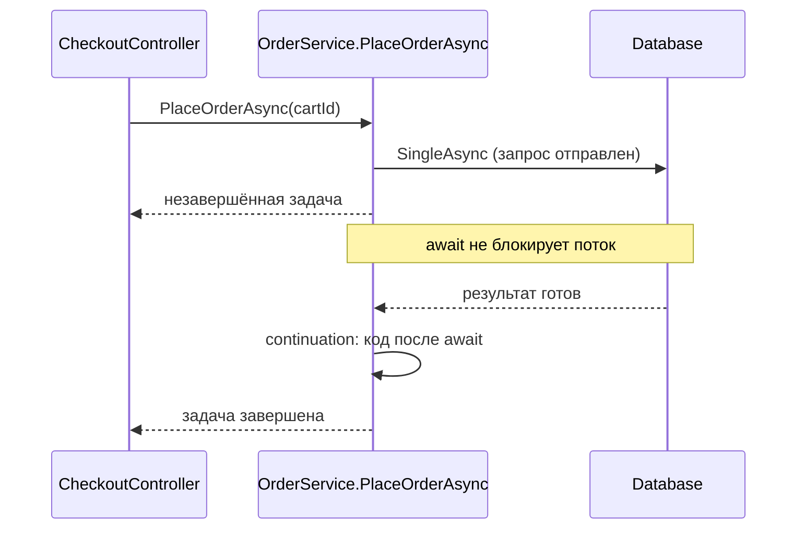

> [!summary]
> Асинхронный код читается как последовательность строк, но выполняется в другом порядке: метод останавливается на `await` и продолжается, когда операция завершилась. Пока операция идёт, `await` не блокирует поток, и поток может обслуживать другую работу. Так сервер держит тысячи одновременных запросов на маленьком пуле потоков, а UI не зависает.

## Asynchrony

Асинхронный код читается как последовательность инструкций, но выполняется в другом порядке. Порядок задают внешние ресурсы и момент, когда завершаются задачи.

Асинхронность — это не параллелизм. Аналогия из документации: завтрак готовит один человек (или поток) и справляется со всеми делами. Подробнее различие — в [[Concurrency vs Parallelism]].

Thread pool — потоки, которые .NET использует для многих видов работы: операций TPL, завершения асинхронного I/O, callbacks таймеров. Подробно — в [[Threads and the Thread Pool]].

**Зачем.** В клиентском приложении UI должен отвечать пользователю, пока скачиваются данные. На сервере заблокированный поток не может обслуживать другие запросы, а за заблокированные потоки вы платите. В ASP.NET Core асинхронные API позволяют небольшому пулу потоков обслуживать тысячи одновременных запросов.

**Механизм.** Поток запускает операцию и не ждёт её завершения. Вместо ожидания поток берёт другой запрос. Когда результат готов, метод продолжается с места `await`. На каком потоке он продолжится, разобрано в разделе Continuations and Context. `async` и `await` сами не создают потоков.

TAP (Task-based Asynchronous Pattern) — модель .NET, в которой асинхронный метод возвращает `Task` или `Task<TResult>`, представляющий идущую операцию. Такие методы получают суффикс `Async`.

```csharp
public interface IOrderRepository
{
    // Синхронно: метод возвращает управление, когда работа закончена
    Order GetOrder(Guid orderId);

    // TAP: метод возвращает задачу, а результат позже запишут в неё
    Task<Order> GetOrderAsync(Guid orderId, CancellationToken ct);
}
```

Правило композиции: если любая часть операции асинхронна, асинхронна вся операция. Поэтому `async` расползается вверх по стеку вызовов: метод, который ждёт асинхронный метод, сам становится асинхронным.

**Key points**
- `async`/`await` не создают потоков.
- Асинхронность ≠ параллелизм: один поток может вести все задачи.
- Выигрыш — пропускная способность сервера и отзывчивость UI, а не скорость одной операции.
- Асинхронность распространяется вверх по стеку.

## I/O-bound vs CPU-bound

Работа бывает двух видов:
- **I/O-bound** — код ждёт внешний результат: ответ БД, HTTP-сервиса, диска.
- **CPU-bound** — код выполняет дорогое вычисление.

**Зачем различать.** От вида работы зависит, нужен ли `Task.Run` вообще.

**Механизм для I/O-bound.** Метод запускает операцию, которую представляет `Task`, и делает `await` на ней — без `Task.Run`. Реализация TAP может использовать асинхронный I/O и не занимать поток большую часть операции. Задача может вообще ничего не выполнять и лишь представлять условие где-то в системе, например приход данных в очередь.

### Waiting Without a Thread

На Windows много одновременных асинхронных I/O-запросов обслуживает механизм ОС — I/O completion ports (IOCP). Поток ждёт на порту completion packet, а не саму I/O-операцию. Пул потоков на одном порту обслуживает много запросов быстрее, чем поток на каждый запрос. Так работают сокеты, named pipes и другие объекты с overlapped I/O.

Отдельный факт про .NET: потоки пула используются в том числе для завершения асинхронного I/O.

> [!warning] Unverified
> Как именно .NET связывает `await` с механизмом ОС на каждой платформе (IOCP на Windows, аналоги на Linux и macOS), здесь не описано: первичного источника на эту цепочку нет.

**Механизм для CPU-bound.** `await Task.Run(...)` переносит вычисление на поток пула. В UI-приложении это держит интерфейс отзывчивым, пока работа идёт в фоне. Фоновый поток не помогает процессу, который только ждёт результат. `Task.Run` не делает синхронный API асинхронным: если запланированный код блокирует поток, `Task.Run` этого не предотвращает. Измеряйте: вычисление может оказаться дешевле, чем накладные расходы на context switches.

**Правило для библиотек.** Асинхронный публичный API выставляют только для I/O-bound работы. Чисто вычислительный метод выставляют только синхронным, а вызывающий код сам решает, переносить ли его в `Task.Run`. Один асинхронный метод может смешивать оба вида: скачать данные, затем отрисовать их.

```csharp
// ASP.NET Core, OrderController
// ❌ BAD: код уже на потоке пула — Task.Run лишь добавляет постановку в очередь
// и не ускоряет ожидание БД.
Order order = await Task.Run(() => _db.Orders.SingleAsync(o => o.Id == orderId, ct));
```

```csharp
// ✅ GOOD: просто await на I/O-задаче, без Task.Run
Order order = await _db.Orders.SingleAsync(o => o.Id == orderId, ct);
```

```csharp
// WPF back-office: отрисовка PDF счёта — CPU-bound
private async void RenderInvoiceButton_Click(object sender, RoutedEventArgs e)
{
    // Вычисление уходит на поток пула, интерфейс остаётся отзывчивым
    byte[] pdf = await Task.Run(() => InvoiceRenderer.Render(_selectedOrder));
    // Результат готов — показываем превью
    _invoicePreview.Show(pdf);
}
```

| | I/O-bound | CPU-bound |
|---|---|---|
| Что делает код | ждёт внешний результат | считает |
| Чем запускать | `await` на I/O-методе | `await Task.Run(...)` |
| Держит ли поток | реализация может не занимать поток большую часть операции | работа идёт на потоке пула |
| Асинхронный API в библиотеке | да | нет, только синхронный |

**Key points**
- CPU-bound: `Task.Run`, и только где это нужно, например чтобы UI оставался отзывчивым.
- Измеряйте, окупается ли перенос вычисления.

## Task

Асинхронное программирование в C# — реализация модели Promise (futures and promises). `Task` представляет идущую операцию и обязательство выдать значение, когда работа завершится. Задача хранит состояние операции и в итоге либо результат, либо исключение.

**Зачем.** Вызывающий код сразу получает объект и сам решает, когда ждать результат.

**Механизм.** Синхронный метод возвращает управление, когда работа закончена. Асинхронный метод возвращает задачу, когда приостанавливается, а результат позже записывается в эту задачу.

Задача async-метода завершается в одном из трёх финальных состояний:
1. `RanToCompletion` — метод дошёл до `return` или до конца тела.
2. `Faulted` — из тела вылетело необработанное исключение.
3. `Canceled` — этим исключением был `OperationCanceledException`.

Все три состояния считаются завершёнными: у отменённой задачи `IsCompleted == true`.

Задачи бывают hot и cold. Задача из публичного конструктора `Task` — cold: она в состоянии `Created` и ждёт вызова `Start`. Все остальные задачи — hot: операция уже запущена. TAP-методы обязаны возвращать запущенные задачи. TAP-метод может завершиться синхронно, например при чтении из буфера, и вернуть уже завершённую задачу.

Задачу, которая не должна занимать поток всё время, создают вручную через `TaskCompletionSource<TResult>` и завершают методами `SetResult`, `SetException`, `SetCanceled`. Создавайте его с `TaskCreationOptions.RunContinuationsAsynchronously`. В обычном TAP-коде задачи не диспоузят. Подробнее — в [[Task and TaskScheduler]].

```csharp
// Вызов: запрос в БД уже ушёл, задача hot
Task<Order> orderTask = _orders.GetOrderAsync(orderId, ct);

// Пока БД отвечает, этот метод делает другую работу: держим Task, ждём позже
decimal discount = await _loyalty.GetDiscountAsync(customerId, ct);

// Если orderTask уже завершена — результат берётся сразу, без приостановки.
// Если нет — метод приостанавливается и вернётся сюда, когда результат запишут в задачу.
Order order = await orderTask;
```

**Key points**
- `Task` — promise: обязательство выдать результат.
- Три финальных состояния, и все три — «завершена».
- Задачи из TAP-методов уже запущены.
- Задача может вернуться уже завершённой.

## async and await

`async` разрешает `await` в методе и заставляет компилятор построить state machine. `await` приостанавливает метод до завершения операции и не блокирует поток.

**Зачем.** По смыслу это `Task.ContinueWith`, но код пишется прямой линией, без callbacks.

**Awaitable.** `await` работает с любым awaitable, а не только с `Task`. Выражение awaitable, если у него есть метод `GetAwaiter()` без параметров. Тип, который `GetAwaiter()` возвращает (awaiter), реализует `INotifyCompletion`, имеет `bool IsCompleted` и `GetResult()` без параметров. Поэтому await-ить можно `ValueTask`, собственные типы и, например, `YieldAwaitable`, который возвращает `Task.Yield()`.

**Механизм.** Вызов async-метода выполняет его тело синхронно, до первого `await` на незавершённом awaitable. Каждый `await t` стандарт C# (§12.9.8.4) раскладывает на четыре шага:
1. Получить awaiter: `a = t.GetAwaiter()`.
2. Прочитать `a.IsCompleted`. Если `true` — fast path: метод не приостанавливается, незачем платить за постановку остатка метода в очередь.
3. Если `false` — зарегистрировать продолжение `r`, то есть делегат, который продолжит метод с этого места. Если awaiter реализует ещё и `ICriticalNotifyCompletion`, вызывается `UnsafeOnCompleted(r)`, иначе `OnCompleted(r)`. Затем метод приостанавливается и возвращает управление текущему вызывающему. При первой приостановке это исходный вызывающий, и он получает незавершённый `Task`. При следующих — код, который запустил продолжение (например, поток пула).
4. При продолжении, или сразу, если `IsCompleted` был `true`, вызвать `a.GetResult()`. Его значение — значение выражения `await`: для `Task<TResult>` это `TResult`. Здесь же бросается исключение упавшей операции.

Чем `OnCompleted` и `UnsafeOnCompleted` различаются внутри — тема [[Async State Machine]].

Где выполнится продолжение на шаге 4, решают два объекта. `SynchronizationContext` — объект, которому можно отправить (`Post`) продолжение. `TaskScheduler` — планировщик задач; текущий scheduler обычно `TaskScheduler.Default`, то есть пул потоков. Правило выбора между ними — в разделе Continuations and Context.

Метод без единого `await` выполняется синхронно, несмотря на `async`, и компилятор выдаёт warning. Сгенерированная state machine в этом случае ничего не даёт.

Миф «async запускает метод в другом потоке» неверен: метод занимает поток, только пока активен.

Приостановка на `await` — не выход из метода: блоки `finally` в этот момент не выполняются.

Ограничения:
- `await` нельзя внутри `lock`, в теле синхронной local function и в теле или инициализаторе `fixed`.
- (C# 15 preview) `await` разрешён в `unsafe`-контексте; в более ранних версиях языка — нет.
- Для взаимного исключения в асинхронном коде есть `SemaphoreSlim.WaitAsync`. Подробнее — в [[Locks and Synchronization]].
- Async-метод не может объявлять параметры `in`, `ref`, `ref readonly`, `out` и возвращать по ссылке.
- `Main` может возвращать `Task` или `Task<int>` и тогда становится async.

```csharp
public sealed class OrderService(AppDbContext db, PaymentGatewayClient gateway)
{
    public async Task<Order> PlaceOrderAsync(Guid cartId, CancellationToken ct = default)
    {
        // Вызов: эта часть выполняется синхронно, в потоке вызывающего кода
        Task<Cart> cartTask = db.Carts.SingleAsync(c => c.Id == cartId, ct);

        // Первый await, шаги 1–2: GetAwaiter, IsCompleted.
        // Задача не завершена → шаг 3: остаток метода регистрируется как continuation,
        // вызывающий получает незавершённый Task<Order>.
        // Задача уже завершена → fast path, продолжаем без паузы.
        Cart cart = await cartTask;

        // Шаг 4 после пробуждения: GetResult вернул Cart, метод идёт дальше
        Order order = Order.FromCart(cart);

        // Второй await: та же логика — либо пауза с возвратом управления, либо fast path
        PaymentResult payment = await gateway.ChargeAsync(order, ct);

        // Пробуждение после оплаты
        order.MarkPaid(payment.TransactionId);
        return order; // результат записывается в Task<Order>, задача завершена
    }
}
```

Тот же вызов на диаграмме:



**Key points**
- До первого незавершённого `await` метод выполняется синхронно.
- `await` никогда не блокирует поток.
- Awaitable определяется формой: `GetAwaiter`, `IsCompleted`, `GetResult`.
- `IsCompleted == true` — fast path без постановки в очередь.
- Исключение бросает `GetResult`.
- Нет `await` — метод синхронный, плюс warning.
- На приостановке `finally` не выполняется.

## Composition: WhenAll and WhenAny

Combinators превращают несколько задач в одну. `Task.WhenAll` завершается, когда завершились все задачи. `Task.WhenAny` возвращает `Task<Task>`, который завершается, когда завершилась любая.

**Зачем.** Одновременность появляется, когда задачу запускают, держат объект `Task` и ждут его позже. Если делать `await` сразу после запуска каждой задачи, выигрыша нет.

**Механизм.**
- `WhenAll` завершается только после завершения всех задач; он не прерывается на первой ошибке.
- Итог `WhenAll`: если хоть одна задача Faulted — Faulted со всеми исключениями; если ни одной Faulted, но есть Canceled — Canceled; иначе RanToCompletion.
- Пустой список задач — задача завершается сразу.
- `WhenAll<TResult>` возвращает результаты в порядке входных задач.
- `await Task.WhenAny` даёт задачу-победителя; чтобы получить её результат или исключение, нужен `await` на ней самой.

LINQ ленив: `Select` выполняется только при перечислении (см. [[LINQ]]). Поэтому без `ToArray()`/`ToList()` асинхронные вызовы не стартуют, и задачи не идут одновременно.

Одновременные ветки не должны делить объекты, которые не thread-safe. `HttpContext` не thread-safe: параллельный доступ из нескольких потоков может подвесить сервер, уронить его или испортить данные. С `DbContext` то же: EF Core не поддерживает параллельные операции на одном экземпляре, включая параллельные async-запросы. Для параллельной работы нужны отдельные экземпляры `DbContext`, например из `IDbContextFactory<TContext>.CreateDbContextAsync`; такой контекст диспоузит вызывающий код.

Блокирующие ожидания заменяются на асинхронные:

| Блокирующий вызов | Асинхронная замена |
|---|---|
| `Task.WaitAny` | `await Task.WhenAny` |
| `Task.WaitAll` | `await Task.WhenAll` |
| `Thread.Sleep` | `await Task.Delay` |

В примерах ниже `InventoryService` и `FraudService` — независимые сервисы без общего `DbContext`; с общим контекстом так запускать нельзя.

```csharp
// ❌ BAD: каждая задача ждётся сразу после запуска — проверка на fraud стартует
// только после резервирования, выигрыша нет
bool reserved = await _inventory.ReserveAsync(order, ct);
FraudVerdict verdict = await _fraud.CheckAsync(order, ct);
```

```csharp
// ✅ GOOD: сначала запускаем обе задачи, потом ждём
Task<bool> stockTask = _inventory.ReserveAsync(order, ct);
Task<FraudVerdict> fraudTask = _fraud.CheckAsync(order, ct);
await Task.WhenAll(stockTask, fraudTask); // ждёт обе, даже если одна упала
bool reserved = await stockTask;          // уже завершена — результат сразу
FraudVerdict verdict = await fraudTask;
```

```csharp
// ❌ BAD: Select ленивый — запрос цены стартует только при перечислении в foreach,
// и цены запрашиваются по одной
IEnumerable<Task<decimal>> priceTasks =
    order.Items.Select(item => _pricing.GetPriceAsync(item.ProductId, ct));
decimal total = 0;
foreach (Task<decimal> priceTask in priceTasks)
    total += await priceTask;

// ✅ GOOD: ToArray() запускает все запросы сразу; результаты — в порядке позиций
Task<decimal>[] startedPriceTasks =
    order.Items.Select(item => _pricing.GetPriceAsync(item.ProductId, ct)).ToArray();
decimal[] prices = await Task.WhenAll(startedPriceTasks);
decimal orderTotal = prices.Sum();
```

**Key points**
- Сначала запусти, потом жди.
- `WhenAll` ждёт все задачи.
- Победителя `WhenAny` нужно ещё раз await-нуть.
- LINQ материализуй через `ToArray()`/`ToList()`.
- Одновременные ветки не делят `HttpContext` и `DbContext`.

## Exceptions

Исключение в async-методе, возвращающем `Task`, переводит задачу в Faulted.

**Зачем знать.** Исключение не вылетает в точке вызова: оно едет внутри `Task` и появляется там, где задачу ждут.

**Механизм.**
- Необработанное исключение в теле → задача Faulted; `OperationCanceledException` → Canceled.
- `Task.Exception` — это `AggregateException`.
- `await` пробрасывает исходное исключение (первое из inner), а не `AggregateException`.
- `.Result` и `Wait()` заворачивают исключение в `AggregateException`.
- С `await` и `GetAwaiter().GetResult()` приходит само исходное исключение, поэтому `catch (AggregateException)` его не поймает.

Контракт TAP: напрямую из вызова бросают только ошибки использования, например `null`-аргумент. Все остальные ошибки кладут в возвращаемую задачу, даже если метод завершился синхронно. Чтобы проверить аргументы сразу, используют гибридный шаблон: публичный не-async метод проверяет и бросает, затем возвращает результат приватного async-метода.

```csharp
public sealed class PaymentService(PaymentGatewayClient gateway) : IPaymentService
{
    public Task<PaymentResult> ChargeAsync(Order order, CancellationToken ct)
    {
        // Ошибка использования: бросаем сразу, в момент вызова
        if (order is null)
            throw new ArgumentNullException(nameof(order));
        return ChargeCoreAsync(order, ct);
    }

    private async Task<PaymentResult> ChargeCoreAsync(Order order, CancellationToken ct)
    {
        PaymentResult payment = await gateway.ChargeAsync(order, ct);
        if (!payment.Succeeded)
            throw new PaymentDeclinedException(order.Id); // попадает в Task → Faulted
        return payment;
    }
}

// Сценарий 1 — order == null:
// ArgumentNullException вылетает прямо на вызове, задача даже не создаётся
Task<PaymentResult> invalidCall = _payments.ChargeAsync(null!, ct);

// Сценарий 2 — платёж отклонён:
Task<PaymentResult> charging = _payments.ChargeAsync(order, ct); // на вызове исключения нет
PaymentResult result = await charging; // PaymentDeclinedException — здесь, на await
```

С `WhenAll` задача может хранить несколько исключений. `await` пробросит только одно. Чтобы увидеть все, держите задачу `WhenAll` в переменной и читайте её `Exception`.

Unobserved exception: если задачу никто не ждал и не читал её `Exception`, исключение эскалируется по политике .NET, когда задачу собирает GC. В modern .NET это событие `TaskScheduler.UnobservedTaskException` при финализации задачи; по умолчанию процесс не падает и продолжает работу. Этот путь недетерминирован и слишком поздний, чтобы корректно обработать ошибку.

Async `Task`-метод не выпускает исключение наружу, а сохраняет его в задаче. Другое правило действует для исключения, которое никто не перехватил в самом потоке пула: оно завершает процесс, за тремя документированными исключениями. Именно так падает процесс от `async void` без `SynchronizationContext` (см. ниже).

**Key points**
- Исключение живёт в `Task`.
- `await` даёт исходный тип исключения.
- `.Result`/`Wait()` дают `AggregateException`.
- Ошибки использования бросают сразу.
- Unobserved-исключение молчит до финализации.

## Cancellation

Отмена кооперативная: вызывающий просит, операция решает.

**Зачем.** В ASP.NET Core minimal API параметр `CancellationToken` обработчика привязан к `HttpContext.RequestAborted`. Этот токен срабатывает, когда обрывается соединение, на котором пришёл запрос, и операции запроса стоит отменить. Но если токен не передан дальше по цепочке, эта часть операции не узнает об отмене.

**Механизм: кто просит.**
- Отмену запрашивают через `CancellationTokenSource`: вызов `Cancel()` переводит связанный `CancellationToken` в состояние `IsCancellationRequested == true` и синхронно выполняет зарегистрированные callbacks.
- `CancelAfter` планирует отмену: отсчёт начинается при вызове, и по истечении задержки источник отменяется.
- `CancellationTokenSource`, созданные для таймаутов, нужно диспоузить: иначе они нагружают очередь таймеров.

**Механизм: кто решает.**
- Операция сама проверяет токен: `ThrowIfCancellationRequested` бросает `OperationCanceledException`, если отмена запрошена.
- Отмена пришла во время работы → операция может её проигнорировать.
- Задача заканчивается Canceled, только если операция завершилась именно из-за отмены.
- `await` на отменённой задаче бросает `OperationCanceledException`.
- Токен передают явно каждому вызову в цепочке.
- Параметр `CancellationToken` стоит добавить, даже если у синхронной версии метода его нет.

```csharp
// Вызывающий (фоновая сверка платежей): создаёт источник отмены с таймаутом
using CancellationTokenSource cts = new();       // источник для таймаута диспоузим
cts.CancelAfter(TimeSpan.FromSeconds(30));       // через 30 с источник отменится
PaymentStatus status = await _poller.WaitForFinalStatusAsync(paymentId, cts.Token);

// Операция: сама проверяет токен и передаёт его дальше
public async Task<PaymentStatus> WaitForFinalStatusAsync(Guid paymentId, CancellationToken ct)
{
    while (true)
    {
        ct.ThrowIfCancellationRequested(); // отмена запрошена → OperationCanceledException
        PaymentStatus status = await _gateway.GetStatusAsync(paymentId, ct); // токен — дальше по цепочке
        if (status != PaymentStatus.Pending)
            return status;
        await Task.Delay(TimeSpan.FromSeconds(2), ct);
    }
}
// OperationCanceledException покидает метод → задача Canceled;
// у вызывающего await бросит OperationCanceledException
```

**Key points**
- Отмена кооперативная.
- Просит `CancellationTokenSource` (`Cancel`, `CancelAfter`), решает операция.
- Токен — через всю цепочку.
- `await` на отменённой задаче → `OperationCanceledException`.

Подробнее — в [[CancellationToken]].

## async void and Fire-and-Forget

`async void` — async-метод, который вызывающий не может await-нуть. Fire-and-forget — запуск задачи, которую потом никто не держит.

**Зачем знать.** В обоих случаях теряются ошибки и момент завершения.

**Механизм async void.**
- У `async void` нет `Task`, поэтому исключение поднимается прямо в `SynchronizationContext`, который был активен при старте метода.
- Если контекста нет (ASP.NET Core, консоль), исключение бросается на потоке пула, а необработанное исключение в потоке пула завершает процесс.
- Вызывающий не может поймать это исключение, и, по документации, оно скорее всего уронит приложение.
- `async void` нужен только для event handlers.
- Вне event handlers его ещё и трудно тестировать, и он даёт побочные эффекты, если вызывающий не ждёт асинхронности.
- В ASP.NET Core `async void` action завершает HTTP-запрос на первом `await`; обращение к `HttpResponse` после этого роняет процесс.

Скрытый `async void`:
- Async lambda, переданная в параметр типа `Action`, становится `async void`; нужен делегат, возвращающий `Task`, например `Func<Task>`.
- Callback с возвратом void, например у `Timer`, подталкивает к `async void`.

**Механизм fire-and-forget.** Брошенная задача создаёт три риска:
1. Операция падает, и исключение никто не видит.
2. Процесс или host останавливается раньше, чем операция закончилась.
3. Операция переживает объект или scope, который должен был её контролировать.

Fire-and-forget без отслеживания допустим, только если выполнены все три условия: работа действительно необязательна, ошибку безопасно игнорировать, и операция заканчивается задолго до конца жизни процесса.

У каждой задачи должен быть владелец: вызывающий код, которому задачу вернули; сервис-владелец, который её отслеживает; или фоновая абстракция, которой управляет host. Остановка владельца идёт в таком порядке:
1. Перестать принимать новую работу.
2. Подать сигнал отмены.
3. Дождаться отслеживаемых задач с ограниченным таймаутом.
4. Залогировать незавершённые операции.

Сама задача не пропадёт из-за GC: runtime держит state machine, пока на неё ссылаются continuations. Работа теряется иначе: владелец потерян, ресурс освобождён раньше времени или процесс завершился.

Частый случай: фоновая работа захватывает request-scoped `DbContext` и падает с `ObjectDisposedException`, потому что выполняется вне scope запроса. По той же причине фоновая работа не должна захватывать `HttpContext`: он действителен, только пока запрос активен, а потом переиспользуется. Подробнее о scopes — в [[Dependency Injection]].

Решение — hosted service: класс, реализующий `IHostedService`, которым управляет host. `BackgroundService` — базовый класс для долгоживущего hosted service. Документация показывает такой шаблон с очередью:
- Обработчик запроса `POST /queue` кладёт work item в bounded очередь и сразу отвечает `202 Accepted`, не дожидаясь выполнения. Если очередь полна, запрос ждёт свободного места — это backpressure.
- `BackgroundService` достаёт work items по одному, await-ит каждый и логирует его исключение.
- Hosted service — singleton, и своего scope у него нет, поэтому scoped-сервисы вроде `DbContext` берут из scope, созданного внутри work item.
- При остановке токен `ExecuteAsync` срабатывает, и реализация должна быстро завершиться. Work items await-ятся до остановки сервиса.

```csharp
// ❌ BAD: async void action — запрос завершается на первом await
[HttpPost("checkout")]
public async void Checkout(Guid cartId)
{
    Order order = await _orders.PlaceOrderAsync(cartId);
    // Запрос уже завершён: обращение к HttpResponse роняет процесс
    Response.StatusCode = StatusCodes.Status201Created;
}
```

```csharp
// ✅ GOOD: action возвращает Task, и запрос не завершается раньше времени
[HttpPost("checkout")]
public async Task<IActionResult> Checkout(Guid cartId)
{
    Order order = await _orders.PlaceOrderAsync(cartId);
    return Ok(order);
}
```

```csharp
// ❌ BAD: задача брошена; EmailService получил AppDbContext из scope запроса.
// Запрос закончился, scope освобождён → ObjectDisposedException, и его никто не увидит
Order order = await _orders.PlaceOrderAsync(cartId, ct);
_ = _email.SendConfirmationAsync(order.Id);
return Ok(order);
```

```csharp
// ✅ GOOD: работа передана владельцу, которым управляет host

// CheckoutController
Order order = await _orders.PlaceOrderAsync(cartId, ct);
Guid orderId = order.Id;
// IBackgroundTaskQueue — интерфейс из примера документации, bounded Channel.
// Кладём work item и не ждём его выполнения
await _queue.QueueBackgroundWorkItemAsync(async stoppingToken =>
{
    // Hosted service — singleton без своего scope: создаём scope внутри work item
    using IServiceScope scope = _scopeFactory.CreateScope();
    EmailService email = scope.ServiceProvider.GetRequiredService<EmailService>(); // свой AppDbContext
    await email.SendConfirmationAsync(orderId, stoppingToken);
});
return Ok(order);

// Владелец задачи: достаёт work items по одному и await-ит каждый
public sealed class QueuedHostedService(IBackgroundTaskQueue queue, ILogger<QueuedHostedService> logger)
    : BackgroundService
{
    protected override async Task ExecuteAsync(CancellationToken stoppingToken)
    {
        while (!stoppingToken.IsCancellationRequested)
        {
            var workItem = await queue.DequeueAsync(stoppingToken);
            try
            {
                await workItem(stoppingToken);
            }
            catch (Exception ex)
            {
                logger.LogError(ex, "Background work item failed"); // ошибка не теряется
            }
        }
    }
}
```

**Key points**
- `async void` — только для event handlers.
- В ASP.NET Core — никогда.
- Следите за async lambda в параметрах `Action`.
- У каждой задачи есть владелец.
- Фоновая работа идёт через hosted service и создаёт свой scope.

## Async State Machine

Компилятор переписывает async-метод в state machine, как и iterator.

**Зачем.** На `await` метод возвращает управление, а его локальные переменные должны дожить до продолжения. Поэтому компилятор поднимает (lifts) локальные переменные в поля сгенерированного типа.

**Механизм (кратко).**
- Метод `MoveNext` содержит всю исходную логику метода.
- В Release state machine — struct, в Debug — класс. Если метод завершился синхронно, struct не покидает стек, и аллокации state machine нет.
- (.NET Core) На первой приостановке struct переезжает в box, который сам и есть возвращаемый `Task`; если метод ждёт только awaitable из System.Private.CoreLib, в худшем случае это одна аллокация на всю жизнь метода. На .NET Framework state machine боксится отдельно.

Как `MoveNext` возобновляет метод с нужного места и почему box — это и есть `Task`, разобрано в [[Async State Machine]].

### Runtime Async

Сегодня async — это переписывание кода компилятором; команда runtime ждёт от реализации в самом runtime выигрыша в производительности.

(.NET 11, preview) Runtime Async заменяет сгенерированные компилятором state machines на приостановку, которой управляет runtime. Включение в проекте: `<Features>runtime-async=on</Features>`.

С Runtime Async живые stack traces (профайлер, отладчик, `new StackTrace()`) показывают настоящие async-методы вместо кадров state machine.

**Key points**
- Struct в Release, класс в Debug.
- Синхронное завершение — без аллокации state machine.
- (.NET Core) если ждём только awaitable из System.Private.CoreLib, худший случай — одна аллокация на жизнь метода.
- Runtime Async — preview-фича в .NET 11.

Подробнее — в [[Async State Machine]].

## Continuations and Context

После приостановки метод где-то продолжается, и правило определяет, где именно.

`SynchronizationContext` — объект, которому можно отправить (`Post`) продолжение; если он был текущим при приостановке, метод продолжается на нём. В GUI-приложениях и в классическом ASP.NET (на .NET Framework) есть `SynchronizationContext`, который пропускает только один кусок кода за раз. В ASP.NET Core `SynchronizationContext` нет.

**Зачем.** В GUI-приложении есть `SynchronizationContext`, и продолжение ставится через его `Post`. Неверная настройка `ConfigureAwait` приводит к потере производительности или к deadlock.

**Механизм.** Порядок поиска по умолчанию:
1. Если в момент приостановки `SynchronizationContext.Current` не `null`, метод продолжится через `Post` этого контекста.
2. Иначе метод полагается на текущий `TaskScheduler`; обычно это `TaskScheduler.Default`, то есть пул потоков.
3. Default scheduler обычно позволяет continuation выполниться на том потоке, где завершилась операция.

`ConfigureAwait(false)` заставляет `await` вести себя так, будто контекста и scheduler нет. Гарантия одна: продолжение не будет поставлено обратно в исходный контекст. Код после `await` всё равно может выполниться в исходном контексте. Например, если awaitable уже завершён, метод не приостанавливается и просто идёт дальше синхронно, так что `ConfigureAwait` там ничего не меняет.

Правило: в коде приложения `ConfigureAwait(false)` не ставят, в библиотеке общего назначения — ставят. В приложении ASP.NET Core по умолчанию нет ни `SynchronizationContext`, ни `TaskScheduler`, поэтому там `ConfigureAwait` ничего не меняет. Это касается кода приложения: библиотеку могут вызвать из GUI-приложения с контекстом.

`ContinueWith` не захватывает `SynchronizationContext` и поэтому ведёт себя иначе, чем `await`.

```csharp
// Библиотека (NuGet-пакет) PaymentGatewayClient: её вызывают и из ASP.NET Core, и из WPF
public async Task<PaymentResult> ChargeAsync(Order order, CancellationToken ct)
{
    ChargeRequest request = new(order.Id, order.Total);

    // ❌ было: await http.PostAsJsonAsync("charges", request, ct);
    //    под GUI-контекстом продолжение уходит через Post в этот контекст
    // ✅ стало: продолжение не ставится обратно в контекст вызывающего
    HttpResponseMessage response = await http.PostAsJsonAsync("charges", request, ct)
        .ConfigureAwait(false); // возвращает ответ, а не тело
    response.EnsureSuccessStatusCode();
    return (await response.Content.ReadFromJsonAsync<PaymentResult>(ct).ConfigureAwait(false))!; // тело ответа читаем тоже без возврата в контекст
}
// В CheckoutController приложения ConfigureAwait не нужен: контекста там нет
```

Подробнее — в [[SynchronizationContext and ConfigureAwait]] и [[Task and TaskScheduler]].

### ExecutionContext

Задача: correlation id запроса должен доехать до логов в коде после каждого `await`, хотя продолжение может выполниться на другом потоке. Для этого есть `ExecutionContext`: он переносит ambient data от одной асинхронной операции к следующей, и на нём построен `AsyncLocal<T>`.
- При продолжении захваченный `ExecutionContext` восстанавливается до запуска continuation.
- Изменения ambient data внутри async-метода не утекают к вызывающему.
- `ExecutionContext` отделён от `SynchronizationContext`; `ConfigureAwait` на его передачу не влияет.
- В .NET Core с `ExecutionContext` обычно передаются impersonation context и culture, а `SynchronizationContext` не передаётся.

```csharp
public static class Correlation
{
    public static readonly AsyncLocal<string?> CorrelationId = new();
}

// Код приложения (CheckoutController), без ConfigureAwait
Correlation.CorrelationId.Value = $"checkout-{order.Id}";
PaymentResult payment = await _gateway.ChargeAsync(order, ct);

// Внутри библиотеки PaymentGatewayClient.ChargeAsync
HttpResponseMessage response = await http.PostAsJsonAsync("charges", request, ct).ConfigureAwait(false);
// Значение на месте: AsyncLocal едет с ExecutionContext, ConfigureAwait его не трогает
logger.LogInformation("Charge sent, correlation {CorrelationId}", Correlation.CorrelationId.Value);
```

**Key points**
- Порядок: SynchronizationContext → TaskScheduler → поток, завершивший операцию.
- `ConfigureAwait(false)` отменяет только постановку обратно в контекст.
- Библиотека — да, приложение — нет.
- `ExecutionContext` ≠ `SynchronizationContext`.

## Sync over Async

Sync over async — блокировка потока в ожидании `Task` через `.Result`, `.Wait()` или `GetAwaiter().GetResult()`.

**Зачем знать.** Это приводит к deadlock под однопоточным контекстом и к thread pool starvation на сервере.

**Механизм deadlock** (GUI-приложение или классический ASP.NET):
1. Обработчик в GUI-контексте вызывает `RefundAsync()`; метод выполняется синхронно до первого `await`.
2. `await` на незавершённой задаче захватывает текущий `SynchronizationContext`, и `RefundAsync` возвращает незавершённый `Task`.
3. Обработчик вызывает `.Result` и блокирует единственный поток контекста.
4. Операция завершается, continuation ставится (`Post`) в захваченный контекст.
5. Выполнить её может только заблокированный поток → оба ждут друг друга вечно.

В консольном приложении тот же код не зависает: continuation выполняется на потоке пула. Поэтому код, который «работает» в консольном тесте, может зависнуть в GUI или классическом ASP.NET. В ASP.NET Core нет `SynchronizationContext`, поэтому классического deadlock нет, но блокировка всё равно ведёт к starvation.

**Механизм starvation.** Starvation — свободных потоков для work items в очереди нет, и runtime в ответ добавляет потоки. Sync over async — самая частая причина starvation. Подробнее — в [[Thread Pool Starvation]] и [[Deadlocks]].

Скрытый sync over async в ASP.NET Core:
- Синхронный `StreamReader.ReadToEnd` по телу запроса: Kestrel не поддерживает синхронное чтение; используйте `ReadToEndAsync`.
- `HttpContext.Request.Form`; используйте `ReadFormAsync`.
- Возврат `IEnumerable<T>` из action: сериализатор перебирает коллекцию синхронно; `IAsyncEnumerable<T>` (ASP.NET Core 3.0+) перечисляется асинхронно.

Решение — `async`/`await` по всему стеку вызовов; блокировка — крайняя мера. Если блокировать всё же приходится, документация ранжирует варианты от лучшего к худшему:
1. `GetAwaiter().GetResult()` — сохраняет исходное исключение, но блокирует и может зависнуть.
2. `Task.Run(...)` + `GetAwaiter().GetResult()` — метод выполняется на потоке пула; помогает избежать некоторых deadlock, но добавляет планирование в пуле.
3. `Wait()` / `Result`.

Метод, который блокирует после первой приостановки (например, `Thread.Sleep` после `await`), тоже не асинхронен: он блокирует любой поток, на котором продолжился.

```csharp
// WPF back-office
// ❌ BAD: блокировка в обработчике события
private void RefundButton_Click(object sender, RoutedEventArgs e)
{
    // Шаг 3: метод уже вернул незавершённый Task; поток GUI-контекста блокируется в .Result
    RefundResult result = _payments.RefundAsync(_selectedOrderId).Result;
    StatusText.Text = result.Status.ToString();
}

// PaymentService (код приложения, без ConfigureAwait)
public async Task<RefundResult> RefundAsync(Guid orderId)
{
    // Шаги 1–2: тело выполняется синхронно до await; await на незавершённой задаче
    // захватывает SynchronizationContext GUI-приложения и возвращает незавершённый Task
    RefundResult result = await _gateway.RefundAsync(orderId);
    // Шаг 4: ответ пришёл, continuation поставлен (Post) в этот контекст
    // Шаг 5: единственный поток контекста заблокирован в .Result → continuation не выполнится → deadlock
    return result;
}
```

```csharp
// ✅ GOOD: тот же обработчик, async до конца;
// event handler — единственное законное место для async void
private async void RefundButton_Click(object sender, RoutedEventArgs e)
{
    try
    {
        RefundResult result = await _payments.RefundAsync(_selectedOrderId);
        StatusText.Text = result.Status.ToString();
    }
    catch (PaymentGatewayException ex) // снаружи async void исключение не поймать
    {
        StatusText.Text = ex.Message;
    }
}
```

**Key points**
- `.Result`, `.Wait()`, `GetAwaiter().GetResult()` — все блокируют.
- Deadlock требует однопоточного контекста.
- В ASP.NET Core вместо deadlock — starvation.
- Решение — async от начала до конца.

## Return Types

Async-метод может возвращать `Task`, `Task<TResult>`, `void` (для event handlers), любой тип с доступным `GetAwaiter`, чей awaiter реализует `ICriticalNotifyCompletion`, и `IAsyncEnumerable<T>`. Собственный возвращаемый тип (task-like) кроме `GetAwaiter` требует builder, указанный атрибутом `[AsyncMethodBuilder]`; так устроен `ValueTask<T>`. Это продвинутый сценарий — по умолчанию хватает `Task`, `Task<TResult>`, `ValueTask<TResult>`. `Task<TResult>` — когда метод возвращает значение типа `TResult`; `Task` — когда `return` без значения или его нет.

**Зачем выбирать.** `Task` и `Task<TResult>` — reference types, и аллокации на горячем пути, особенно в tight loops, могут бить по производительности.

**Механизм.**
- `ValueTask<TResult>` — лёгкий value type (struct) для горячих путей.
- По умолчанию используют `Task`; `ValueTask` — только когда замеры показывают давление аллокаций и потребители справятся с его ограничениями.
- Async stream позволяет перебирать элементы, которые приходят по частям через повторные асинхронные вызовы. Async-метод может возвращать для этого `IAsyncEnumerable<T>`.
- `await using` освобождает объект, реализующий `IAsyncDisposable`.

| | `Task<T>` | `ValueTask<T>` |
|---|---|---|
| Тип | reference type | value type |
| Аллокация | есть | можно избежать |
| Выбор по умолчанию | да | только после замеров |

Ограничения `ValueTask`:
- Его потребляют один раз: второй `await` или чтение результата до завершения может бросить исключение или испортить состояние.
- Как правило, его await-ят сразу, не отбрасывают и не сохраняют в локальные переменные или поля.
- Если всё же нужно сохранить или await-нуть дважды, вызывают `AsTask()`.

```csharp
// Admin-страница: заказы отдаются асинхронно по мере готовности
await foreach (Order order in _orders.StreamPendingAsync(ct))
{
    await _fraud.RecheckAsync(order, ct);
}
```

**Key points**
- По умолчанию `Task`.
- `ValueTask` — потребить один раз.
- Async streams — для источников, которые отдают элементы асинхронно по частям.

Подробнее — в [[ValueTask]] и [[Async Streams]].

## Async Rules and Analyzers

Правила, которые senior проверяет на code review, и analyzers, которые их ловят.

1. Суффикс `Async` — у методов, возвращающих awaitable; у синхронных методов его нет. Analyzer: VSTHRD200.
2. Не блокироваться на задачах: `.Result` и `.Wait()` избегать полностью. Analyzers: CA1849 — синхронные вызовы при наличии Async-версии и блокировка внутри методов, возвращающих `Task` (не включён по умолчанию в .NET 10); VSTHRD002.
3. Никаких `async void`, кроме event handlers. Analyzer: VSTHRD100.
4. Не бросать задачи. Analyzer: VSTHRD110 — задачи из async-методов нужно await-ить или сохранять для наблюдения.
5. `ConfigureAwait(false)` — только в библиотеках. Analyzer: CA2007 (не включён по умолчанию в .NET 10) — для библиотек; в коде приложения его подавляют.
6. `ValueTask` использовать правильно: await-ить сразу, не отбрасывать и не хранить. Analyzer: CA2012 (включён как suggestion в .NET 10).
7. Синхронная часть async-метода — минимальная, чтобы метод быстро вернул управление вызывающему.
8. `await` вместо `ContinueWith`. Для уже готового значения — `Task.FromResult`, а не `Task.Run`.
9. Eliding (вернуть `Task` напрямую без `async`/`await`) всегда быстрее, потому что работы меньше, но меняет поведение. С `async`/`await` синхронные и асинхронные исключения одинаково приходят через задачу, код легче менять (например, добавить `using`), а async locals не утекают из метода.

```csharp
// Вариант 1, eliding: меньше работы, но поведение исключений и AsyncLocal другое
public Task<Order> GetOrderAsync(Guid orderId, CancellationToken ct) =>
    _repository.GetOrderAsync(orderId, ct);
```

```csharp
// Вариант 2, тот же метод с async/await: исключения всегда приходят через Task,
// AsyncLocal не утекает, и метод легко дополнить, например using
public async Task<Order> GetOrderAsync(Guid orderId, CancellationToken ct) =>
    await _repository.GetOrderAsync(orderId, ct);
```

## Pitfalls & Trade-offs

1. **Блокировка на async (`.Result`, `.Wait()`, `GetAwaiter().GetResult()`).** Синхронный helper в checkout вызывает `ChargeAsync(...).Result`. В GUI или классическом ASP.NET это deadlock: continuation ждёт заблокированный поток. В ASP.NET Core классического deadlock нет, но поток пула заблокирован, и под нагрузкой наступает starvation.
   ```csharp
   PaymentResult blocked = _gateway.ChargeAsync(order, ct).Result; // ❌ блокирует поток
   PaymentResult result = await _gateway.ChargeAsync(order, ct);   // ✅
   ```
2. **`async void` вне event handlers.** `async void` action обращается к `HttpResponse` после первого `await` — процесс падает. Исключения из `async void` не поймать снаружи. Тот же эффект даёт async lambda в параметре `Action` и callback `Timer`.
   ```csharp
   // List<T>.ForEach принимает Action<T>;
   // async lambda в параметре Action возвращает void и получает все проблемы async void
   pendingOrders.ForEach(async o => await _email.SendConfirmationAsync(o.Id)); // ❌
   ```
3. **Брошенная задача с request-scoped состоянием.** Отправка письма захватила `AppDbContext` запроса → `ObjectDisposedException`. Задачу никто не ждёт, поэтому ошибка всплывёт только при финализации, а процесс в modern .NET по умолчанию не упадёт.
4. **Последовательные `await` и ленивый LINQ.** Резервирование и fraud-проверка идут одна за другой, хотя независимы. `Select` без `ToArray()` не запускает запросы до перечисления.
5. **`Task.Run` в ASP.NET Core и `Task.Run` вокруг синхронного API.** Код уже на потоке пула; `Task.Run` добавляет планирование и не устраняет блокировку. Библиотека не должна выдавать вычисление за async-метод.
6. **«async = быстрее / в другом потоке».** Async-метод без `await` выполняется синхронно, а state machine только тратит ресурсы. `Thread.Sleep` после первой приостановки блокирует поток, на котором метод продолжился.
   ```csharp
   PaymentResult payment = await _gateway.ChargeAsync(order, ct);
   Thread.Sleep(500);              // ❌ блокирует поток продолжения
   await Task.Delay(500, ct);      // ✅
   ```
7. **Только одно исключение из `await Task.WhenAll`.** Упали и склад, и fraud-сервис, а в логе одна ошибка. Все ошибки — в `Exception` задачи `WhenAll`.
8. **`HttpContext` в параллельных ветках или после конца запроса.** `HttpContext` не thread-safe: параллельный доступ из веток `WhenAll` может подвесить сервер, уронить его или испортить данные. После завершения запроса `HttpContext` переиспользуется.
9. **Скрытый синхронный I/O в ASP.NET Core.** `ReadToEnd` по телу запроса, `Request.Form`, возврат `IEnumerable<T>` из action.
10. **Неправильный `ConfigureAwait`.** Библиотека без `ConfigureAwait(false)` под GUI-контекстом ставит продолжение после приостановки через `Post` этого контекста. В коде приложения ASP.NET Core `ConfigureAwait` ничего не меняет, но библиотеке он нужен. Неверное значение ведёт к потере производительности или deadlock.

Trade-offs:
- Async покупает пропускную способность и отзывчивость ценой аллокации при приостановке.
- `Task.Run` покупает отзывчивый UI ценой планирования в пуле и context switches.
- Eliding `async`/`await` покупает меньше работы ценой другого поведения исключений и async locals.
- `ValueTask` покупает меньше аллокаций ценой правила «потребить один раз».
- `ConfigureAwait(false)` покупает отказ от возврата в контекст ценой того, что код после `await` не может рассчитывать на исходный контекст.

## In Production

**Система.** Checkout API на ASP.NET Core. `PaymentService.Charge(Order order)` — синхронный метод из legacy-интерфейса. Внутри он вызывает `_gateway.ChargeAsync(order).GetAwaiter().GetResult()`, и action контроллера тоже синхронный. Заодно action читает заказ синхронным `Single`, хотя у EF Core есть `SingleAsync`.

```csharp
// ❌ BAD: sync over async в каждом запросе на оплату
public sealed class PaymentService(PaymentGatewayClient gateway) : IPaymentService
{
    public PaymentResult Charge(Order order) =>
        gateway.ChargeAsync(order, CancellationToken.None).GetAwaiter().GetResult(); // поток пула стоит
}

[HttpPost("{orderId:guid}/pay")]
public IActionResult Pay(Guid orderId)
{
    Order order = _db.Orders.Single(o => o.Id == orderId); // синхронный вызов, хотя есть SingleAsync
    PaymentResult result = _payments.Charge(order);
    return Ok(result);
}
```

**Симптом.** На пике трафика растёт latency, а CPU остаётся намного ниже 100%. `dotnet.thread_pool.thread.count` растёт медленно и равномерно; часто очередь пула длинная, а завершённых work items мало.

Диагностический порог из документации: число потоков стабилизируется выше примерно трёхкратного числа ядер — обычно это значит, что код приложения блокирует потоки пула.

Для сравнения, в учебном прогоне из документации (.NET 9+) число потоков быстро дошло до 2–3x числа ядер, а затем росло на 1–2 потока в секунду. Это наблюдение одного прогона, а не алгоритм пула. С .NET 6 эвристики пула быстрее добавляют потоки при блокировке на некоторых Task API; starvation становится короче, но не исчезает.

**Диагностика**:
- `dotnet-counters` — число потоков пула и длина очереди.
- `dotnet-stack` или dump — стеки заблокированных потоков.
- `dotnet-trace` с событием `WaitHandleWait` (.NET 9+) — оно срабатывает, когда поток блокируется, в том числе на sync-over-async вызовах и `lock`.

**Неправильные исправления.**
- Поднять `ThreadPool.SetMinThreads`: лишнее увеличение минимума само может ухудшить производительность.
- Обернуть вызов в `Task.Run`: это только добавляет планирование и не устраняет блокировку.

**Исправление** — async по всему стеку и токен через всю цепочку:

```csharp
// ✅ GOOD
public sealed class PaymentService(PaymentGatewayClient gateway) : IPaymentService
{
    public async Task<PaymentResult> ChargeAsync(Order order, CancellationToken ct) =>
        await gateway.ChargeAsync(order, ct);
}

[HttpPost("{orderId:guid}/pay")]
public async Task<IActionResult> Pay(Guid orderId, CancellationToken ct)
{
    Order order = await _db.Orders.SingleAsync(o => o.Id == orderId, ct);
    PaymentResult result = await _payments.ChargeAsync(order, ct); // поток пула свободен, пока шлюз отвечает
    return Ok(result);
}
```

Долгую блокирующую работу выносят из обработки запроса: на выделенный поток или в background service, например по шаблону очереди из раздела async void and Fire-and-Forget.

## Questions

> [!qard]- Создаёт ли `async`/`await` новый поток? Что происходит с потоком на `await`?
> Нет. `async` и `await` потоков не создают; метод занимает поток только пока активен.
> Метод выполняется синхронно до первого `await` на незавершённой задаче. Там остаток метода регистрируется как continuation, а поток возвращается к вызывающему. Реализация TAP может использовать асинхронный I/O и не занимать поток большую часть операции. Потоки пула .NET используются в том числе для завершения асинхронного I/O.
> Оговорка: для CPU-bound работы поток всё же нужен, и её переносят через `Task.Run`; ожиданию результата фоновый поток не помогает.

> [!qard]- Чем асинхронность отличается от параллелизма, и когда нужен `Task.Run`?
> Асинхронность — не параллелизм: один поток может вести все задачи в полёте.
> I/O-bound работу await-ят без `Task.Run`. CPU-bound работу переносят в `Task.Run`, например чтобы UI оставался отзывчивым. Библиотека выставляет вычисление только синхронным, а решение о переносе принимает вызывающий.
> В ASP.NET Core `Task.Run` с немедленным `await` вреден: код уже на потоке пула, и это только лишнее планирование.

> [!qard]- Почему `.Result` вызывает deadlock в WPF или классическом ASP.NET, но не в ASP.NET Core? Можно ли тогда блокировать в ASP.NET Core?
> В GUI-приложениях и классическом ASP.NET есть `SynchronizationContext`, который пропускает один кусок кода за раз. Внутренний `await` захватывает контекст и возвращает незавершённую задачу, затем поток блокируется в `.Result`, а continuation ставится в захваченный контекст. Выполнить её может только заблокированный поток, поэтому оба ждут вечно.
> В ASP.NET Core `SynchronizationContext` нет, поэтому классического deadlock нет. `GetAwaiter().GetResult()` отличается от `.Result` только формой исключения и блокирует так же.
> Блокировать всё равно нельзя: заблокированный поток не обслуживает другую работу, а sync over async — самая частая причина thread pool starvation.

> [!qard]- Что компилятор генерирует для `async`-метода, и сколько это стоит?
> Компилятор переписывает метод в state machine, как iterator. В IL — структура с кодом метода и stub-метод с `[AsyncStateMachine]`. `MoveNext` содержит исходную логику, а локальные переменные становятся полями. Каждый `await` идёт по шаблону `GetAwaiter` → `IsCompleted` → `OnCompleted`/`UnsafeOnCompleted` → `GetResult`.
> В Release state machine — struct: при синхронном завершении она не покидает стек, и аллокации нет. В Debug это классы. (.NET Core) При первой приостановке struct переезжает в box, который и есть `Task`; если метод ждёт только awaitable из System.Private.CoreLib, худший случай — одна аллокация на жизнь метода.
> (.NET 11, preview) Runtime Async заменяет сгенерированные state machines приостановкой, которой управляет runtime; включается через `<Features>runtime-async=on</Features>`.

> [!qard]- Что делает `ConfigureAwait(false)`, где его ставить, и останавливает ли он `AsyncLocal`?
> Он заставляет `await` вести себя так, будто нет ни `SynchronizationContext`, ни `TaskScheduler`. Без него продолжение идёт в захваченный `SynchronizationContext`, иначе в текущий `TaskScheduler`.
> Гарантия одна: продолжение не ставится обратно в исходный контекст; код всё равно может выполниться там, если awaitable уже завершён. Ставить — в библиотеках общего назначения, не ставить — в коде приложения. В приложении ASP.NET Core он ничего не меняет, потому что контекста нет.
> `AsyncLocal` он не останавливает: `AsyncLocal<T>` едет с `ExecutionContext`, который отделён от `SynchronizationContext`.

> [!qard]- Как ведут себя исключения в `async`-коде и в `Task.WhenAll`?
> Исключение не вылетает на вызове, а переводит задачу в Faulted и лежит в `Task.Exception`. `await` пробрасывает исходное исключение, а `.Result`/`Wait()` — `AggregateException`. С `await` и `GetAwaiter().GetResult()` поймать `AggregateException` нельзя.
> По контракту TAP напрямую бросают только ошибки использования, остальное — в задачу.
> `WhenAll` ждёт все задачи и собирает все исключения. `await` отдаёт только одно, поэтому для полного списка держат задачу `WhenAll` в переменной и читают её `Exception`.

> [!qard]- Почему `async void` опасен и где он допустим?
> У `async void` нет `Task`: вызывающий не может его дождаться и не может поймать его исключения. Исключение поднимается прямо в `SynchronizationContext`, активный при старте метода, а если контекста нет (ASP.NET Core, консоль) — бросается на потоке пула; в обоих случаях оно скорее всего роняет приложение.
> Допустим только в event handlers. В ASP.NET Core `async void` action завершает запрос на первом `await`, а позднее обращение к `HttpResponse` роняет процесс.
> Ловушка: async lambda, переданная в `Action`, — это тоже `async void`; нужен делегат, возвращающий `Task`, например `Func<Task>`.

> [!qard]- Как правильно запустить фоновую работу из запроса (fire-and-forget)?
> Не бросать задачу: брошенная задача теряет ошибки, может не успеть до остановки host и пережить свой scope. Без отслеживания можно, только если работа необязательна, ошибку безопасно игнорировать и операция заканчивается задолго до конца процесса.
> Правильно — отдать работу владельцу, которым управляет host. Шаблон из документации: обработчик запроса кладёт work item в bounded очередь и сразу отвечает `202 Accepted`, а `BackgroundService` достаёт work items по одному, await-ит и логирует ошибки. Hosted service — singleton без своего scope, поэтому `DbContext` берут из scope, созданного через `IServiceScopeFactory` внутри work item; иначе захваченный `DbContext` запроса даст `ObjectDisposedException`.
> При остановке владелец перестаёт брать работу, отменяет, ждёт задачи с таймаутом и логирует незавершённые.

> [!qard]- Как устроена отмена асинхронной операции в .NET?
> Отмена кооперативная: вызывающий просит, а операция решает, принять ли запрос. Просят через `CancellationTokenSource`: `Cancel()` переводит токен в `IsCancellationRequested == true` и выполняет зарегистрированные callbacks, а `CancelAfter` планирует отмену по таймауту. Источники для таймаутов диспоузят.
> Операция проверяет токен, например через `ThrowIfCancellationRequested`, и передаёт его явно каждому вызову в цепочке. Если она завершилась из-за отмены, задача Canceled, а `await` на ней бросает `OperationCanceledException`.
> В ASP.NET Core minimal API токен-параметр привязан к `HttpContext.RequestAborted`, который срабатывает, когда обрывается соединение запроса. Подробнее — в [[CancellationToken]].

> [!qard]- Зачем нужен `ValueTask` и почему он не выбор по умолчанию?
> `Task` — reference type, и аллокации на горячем пути могут бить по производительности; `ValueTask<TResult>` — value type, который позволяет их избежать.
> Но по умолчанию возвращают `Task`, а `ValueTask` — только когда замеры показывают давление аллокаций и потребители справятся с его ограничениями. `ValueTask` потребляют один раз: второй `await` или чтение результата до завершения может бросить исключение или испортить состояние. Если его нужно сохранить или await-нуть дважды, вызывают `AsTask()`. Нарушения ловит CA2012. Подробнее — в [[ValueTask]].

## Related

- Sub-notes: [[Async State Machine]], [[Task and TaskScheduler]], [[ValueTask]], [[CancellationToken]], [[SynchronizationContext and ConfigureAwait]], [[Async Streams]], [[Thread Pool Starvation]]
- [[Threads and the Thread Pool]]
- [[Concurrency vs Parallelism]]
- [[Multithreading]]
- [[Locks and Synchronization]]
- [[Deadlocks]]
- [[Race Conditions]]
- [[Exceptions]]
- [[LINQ]]
- [[Dependency Injection]]

## References

- [Asynchronous programming with async and await](https://learn.microsoft.com/en-us/dotnet/csharp/asynchronous-programming/)
- [Asynchronous programming scenarios](https://learn.microsoft.com/en-us/dotnet/csharp/asynchronous-programming/async-scenarios)
- [Task asynchronous programming model](https://learn.microsoft.com/en-us/dotnet/csharp/asynchronous-programming/task-asynchronous-programming-model)
- [Async return types](https://learn.microsoft.com/en-us/dotnet/csharp/asynchronous-programming/async-return-types)
- [Generate and consume async streams](https://learn.microsoft.com/en-us/dotnet/csharp/asynchronous-programming/generate-consume-asynchronous-stream)
- [await operator](https://learn.microsoft.com/en-us/dotnet/csharp/language-reference/operators/await)
- [async keyword](https://learn.microsoft.com/en-us/dotnet/csharp/language-reference/keywords/async)
- [C# standard: Expressions, §12.9.8 Await expressions](https://github.com/dotnet/csharpstandard/blob/standard-v7/standard/expressions.md)
- [Task-based asynchronous pattern (TAP)](https://learn.microsoft.com/en-us/dotnet/standard/asynchronous-programming-patterns/task-based-asynchronous-pattern-tap)
- [Implementing the Task-based Asynchronous Pattern](https://learn.microsoft.com/en-us/dotnet/standard/asynchronous-programming-patterns/implementing-the-task-based-asynchronous-pattern)
- [Consuming the Task-based Asynchronous Pattern](https://learn.microsoft.com/en-us/dotnet/standard/asynchronous-programming-patterns/consuming-the-task-based-asynchronous-pattern)
- [Task exception handling](https://learn.microsoft.com/en-us/dotnet/standard/asynchronous-programming-patterns/task-exception-handling)
- [Keep async methods alive](https://learn.microsoft.com/en-us/dotnet/standard/asynchronous-programming-patterns/keep-async-methods-alive)
- [Exception handling (Task Parallel Library)](https://learn.microsoft.com/en-us/dotnet/standard/parallel-programming/exception-handling-task-parallel-library)
- [The managed thread pool](https://learn.microsoft.com/en-us/dotnet/standard/threading/the-managed-thread-pool)
- [Task.WhenAll](https://learn.microsoft.com/en-us/dotnet/api/system.threading.tasks.task.whenall)
- [Task.Yield](https://learn.microsoft.com/en-us/dotnet/api/system.threading.tasks.task.yield)
- [CancellationTokenSource.Cancel](https://learn.microsoft.com/en-us/dotnet/api/system.threading.cancellationtokensource.cancel), [CancellationTokenSource.CancelAfter](https://learn.microsoft.com/en-us/dotnet/api/system.threading.cancellationtokensource.cancelafter), [CancellationToken.ThrowIfCancellationRequested](https://learn.microsoft.com/en-us/dotnet/api/system.threading.cancellationtoken.throwifcancellationrequested)
- [HttpContext.RequestAborted](https://learn.microsoft.com/en-us/dotnet/api/microsoft.aspnetcore.http.httpcontext.requestaborted), [Minimal APIs parameter binding](https://learn.microsoft.com/en-us/aspnet/core/fundamentals/minimal-apis/parameter-binding)
- [ExecutionContext](https://learn.microsoft.com/en-us/dotnet/api/system.threading.executioncontext)
- [AsyncStateMachineAttribute](https://learn.microsoft.com/en-us/dotnet/api/system.runtime.compilerservices.asyncstatemachineattribute)
- [List<T>.ForEach](https://learn.microsoft.com/en-us/dotnet/api/system.collections.generic.list-1.foreach)
- [HttpClientJsonExtensions.PostAsJsonAsync](https://learn.microsoft.com/en-us/dotnet/api/system.net.http.json.httpclientjsonextensions.postasjsonasync), [HttpContentJsonExtensions.ReadFromJsonAsync](https://learn.microsoft.com/en-us/dotnet/api/system.net.http.json.httpcontentjsonextensions.readfromjsonasync)
- EF Core: [DbContext lifetime, configuration, and initialization](https://learn.microsoft.com/en-us/ef/core/dbcontext-configuration/), [SingleAsync](https://learn.microsoft.com/en-us/dotnet/api/microsoft.entityframeworkcore.entityframeworkqueryableextensions.singleasync), [IDbContextFactory.CreateDbContextAsync](https://learn.microsoft.com/en-us/dotnet/api/microsoft.entityframeworkcore.idbcontextfactory-1.createdbcontextasync)
- [Debug ThreadPool starvation](https://learn.microsoft.com/en-us/dotnet/core/diagnostics/debug-threadpool-starvation)
- [What's new in the .NET 11 runtime](https://learn.microsoft.com/en-us/dotnet/core/whats-new/dotnet-11/runtime)
- [AsyncVoidMethodBuilder.cs (dotnet/runtime)](https://github.com/dotnet/runtime/blob/main/src/libraries/System.Private.CoreLib/src/System/Runtime/CompilerServices/AsyncVoidMethodBuilder.cs) — путь исключения `async void` без контекста
- [Runtime async design spec (dotnet/runtime)](https://github.com/dotnet/runtime/blob/main/docs/design/specs/runtime-async.md)
- [ASP.NET Core best practices](https://learn.microsoft.com/en-us/aspnet/core/fundamentals/best-practices)
- [Background tasks with hosted services in ASP.NET Core](https://learn.microsoft.com/en-us/aspnet/core/fundamentals/host/hosted-services)
- [I/O completion ports (Win32)](https://learn.microsoft.com/en-us/windows/win32/fileio/i-o-completion-ports)
- Code analysis rules: [CA2007](https://learn.microsoft.com/en-us/dotnet/fundamentals/code-analysis/quality-rules/ca2007), [CA1849](https://learn.microsoft.com/en-us/dotnet/fundamentals/code-analysis/quality-rules/ca1849), [CA2012](https://learn.microsoft.com/en-us/dotnet/fundamentals/code-analysis/quality-rules/ca2012)
- vs-threading analyzers: [VSTHRD002](https://microsoft.github.io/vs-threading/analyzers/VSTHRD002.html), [VSTHRD100](https://microsoft.github.io/vs-threading/analyzers/VSTHRD100.html), [VSTHRD110](https://microsoft.github.io/vs-threading/analyzers/VSTHRD110.html), [VSTHRD200](https://microsoft.github.io/vs-threading/analyzers/VSTHRD200.html)
- [How async/await really works in C#](https://devblogs.microsoft.com/dotnet/how-async-await-really-works/) — .NET team blog
- [ConfigureAwait FAQ](https://devblogs.microsoft.com/dotnet/configureawait-faq/) — .NET team blog
- SUPPORTING: [Async/Await — Best Practices in Asynchronous Programming](https://learn.microsoft.com/en-us/archive/msdn-magazine/2013/march/async-await-best-practices-in-asynchronous-programming) — MSDN Magazine, 2013, эпоха .NET Framework 4.5
- SUPPORTING: [AsyncGuidance.md (AspNetCoreDiagnosticScenarios)](https://github.com/davidfowl/AspNetCoreDiagnosticScenarios/blob/master/AsyncGuidance.md) — гайд участника команды .NET, не официальная документация
